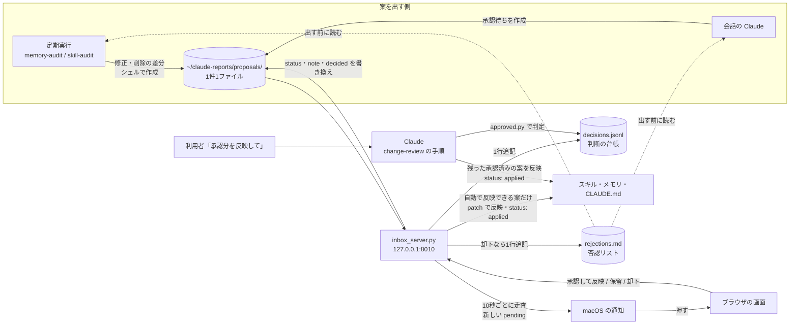

# claude-review-inbox

| 項目 | 内容 |
| --- | --- |
| 対象 | Claude Code のスキル・メモリ・CLAUDE.md に対する承認待ちの変更 |
| 動作環境 | 必須: macOS、Xcode のコマンドラインツール（`/usr/bin/python3` 3.9 以上の実体）。任意: Homebrew と `terminal-notifier`（押すと画面が開く通知。無ければ `osascript` で出し、押しても画面は開かない）、`claude`（週1回の見直しに使う）。`install.sh` は `jq` を使わない（`memory-audit` のスクリプトは `/usr/bin/jq` を使う） |
| ライセンス | MIT（[LICENSE](LICENSE)） |

本書は、claude-review-inbox の入れ方・更新・外し方と、仕組みを説明する。

## 1. 概要

Claude Code の決まり（スキル・メモリ・CLAUDE.md）を直す変更のうち、利用者の判断が必要なものを「承認待ち」として1件1ファイルで置き、ブラウザの画面で承認・保留・却下する。

- 承認待ちは `~/claude-reports/proposals/` に、frontmatter 付きの Markdown で置く。書式は [core/skills/change-review/SKILL.md](core/skills/change-review/SKILL.md) が定める。
- 画面は `http://127.0.0.1:8010/` である。手元で常に動く小さな HTTP サーバー（launchd の LaunchAgent）が表示する。
- 承認待ちが増えると、サーバーが macOS の通知を出す。通知を押すと、一覧の画面でその案のカードが開く。
- 却下した変更は否認リスト（`~/claude-reports/proposals/rejections.md`）に残る。案を出す側は、出す前に否認リストを読み、同じ対象・同じ趣旨の修正・削除を二度と出さない。
- 画面の「承認して反映」を押すと、サーバーが承認を記録し、続けて案の差分を対象のファイルへ `patch` で当てる（`claude` は使わない）。スキルの削除・移し先の確認が必要な案など、自動では反映しない案は承認済みのまま残り、利用者が会話で「承認分を反映して」と言ったときに Claude が反映する（「3.4」）。

`install.sh` で入れると、次の5つがそろう。

| 機能 | 内容 |
| --- | --- |
| 承認の画面 | `http://127.0.0.1:8010/` の一覧で、承認して反映・保留・却下する |
| レポートの欄 | 同じ画面の上のトグルで「レポート」（`/reports`）に切り替え、定期実行のレポート（`~/claude-reports/<ジョブ名>/<YYYY-MM-DD>.md`）を読んで既読にする。既読の記録は `~/.local/state/claude-reports/report-inbox/read.txt` に追記する。レポートの置き場所にジョブのディレクトリが1つも無ければ、トグルにレポートの項目は出ない |
| スキルの欄 | 同じ画面の上のトグルで「スキル（N 件）」（`/skills`）に切り替え、スキルの一覧と、各スキルの Markdown を整形した表示を読む。見るだけで、編集・削除はできない（POST は 405 を返す）。置き場所は環境変数 `CLAUDE_SKILLS_DIR`、無ければ `${CLAUDE_CONFIG_DIR:-~/.claude}/skills` とし、直下のディレクトリ（シンボリックリンクを含む）のうち `SKILL.md` を持つものを数える。`.` で始まるもの・`synced`・環境変数 `CLAUDE_SKILLS_EXCLUDE`（カンマ区切り）に書いた名前は数えない。スキルが1件も無ければ、トグルにスキルの項目は出ない。レポートとスキルの項目がどちらも無ければ、トグルそのものを出さない |
| 通知 | 承認待ちが増えたら macOS の通知を出す |
| 承認の決まり | Skill `change-review`。案の書式・承認の判定・反映の手順を定める |
| 週1回の見直し（任意） | Skill `memory-audit`（メモリ）・`skill-audit`（スキル）・`feedback-mining`（会話の履歴からの決まりの案）。週1回 `claude -p` を動かす。追加はその場で反映し、修正と削除は承認待ちにする。`install.sh` が登録するかを聞く（「4.1 週1回の見直し」） |
| 結果の一覧 | Skill `report-inbox`。定期実行の結果の未読と失敗を、会話の開始時に1行で出す（SessionStart フック） |
| 見回り | Skill `repo-patrol`（手元のリポジトリの未コミット・未 push）と `secret-patrol`（秘密情報と個人情報の置き忘れ）。会話の開始時に SessionStart フックが裏で動かす。見回る範囲は `install.sh` が聞く（「4.2 見回りの範囲」） |

### 1.1 承認制にする範囲

| 変更 | 扱い |
| --- | --- |
| CLAUDE.md の変更（追加を含む） | 承認待ち |
| 会話の履歴から作った決まりの案 | 承認待ち |
| Claude Code の安全チェックに止められた、自身の決まりの変更 | 承認待ち |
| 定期実行が自分で見つけたスキル・メモリの修正と削除 | 承認待ち。定期実行のスクリプトが案を作る |
| 定期実行が自分で見つけたスキル・メモリの追加（既存の行を変えない・消さない変更） | 承認なしで反映し、記録だけ残す |
| 会話の中でのスキル・メモリの直し | 対象外 |

## 2. 構成

| パス | 内容 |
| --- | --- |
| `install.sh` | 入れる・外す。オプションは `--with-schedule`・`--no-schedule`・`--yes`・`--dry-run`・`--uninstall` |
| `core/skills/change-review/` | 承認待ちの手順（`SKILL.md`）と `scripts/`（承認済みの判定 `approved.py`、件数の集計 `count.sh`、案の作成 `new-proposal.sh`・`diff-label.sh`、共通部品 `proposal_lib.py`、画面の「承認して反映」の処理 `apply_lib.py`） |
| `core/server/inbox_server.py` | 画面・ボタンの処理・置き場所の見張りと通知 |
| `core/server/markdown_lite.py` | スキルの欄の Markdown の整形。標準ライブラリだけで動き、生の HTML はすべてエスケープする |
| `core/skills/memory-audit/`・`feedback-mining/`・`skill-audit/` | 週1回の見直しの3つ。各スキルが `launchd/<ジョブ名>.plist.template` を持つ |
| `core/skills/report-inbox/` | 定期実行の結果の一覧と既読の管理。`scripts/unread.sh` を SessionStart フックに登録する |
| `core/skills/repo-patrol/`・`secret-patrol/` | 見回りの2つ。`scripts/run-if-due.sh`・`scripts/session-trigger.sh` を SessionStart フックに登録する |
| `core/launchd/claude-review-inbox.plist.template` | サーバーの plist のひな形。`install.sh` がパスとラベルを埋める |
| `core/tests/` | テスト。`core/tests/run.sh` で全部動く |
| `LICENSE` | MIT License |

## 3. 仕組み



### 3.1 承認の改ざん対策

案のファイルの `status: approved` は誰でも（定期実行の `claude -p` でも）書けるため、それだけでは承認として扱わない。

1. 画面のボタンが押されるたびに、サーバーが判断の台帳 `~/.local/state/claude-review-inbox/decisions.jsonl` に1行追記する。項目は `id`・`to`・`note`・`sha256`（frontmatter を除いた本文の SHA-256）・`at` である。「承認して反映」で反映できたときは、`"to": "approved"` の行に続けて `"to": "applied"` の行を足す。
2. 反映の手順では、ファイルの `status: approved`、台帳の最新の行が `approved`、台帳の `sha256` と今の本文の SHA-256 の一致、の3つがそろった案だけを承認済みとする。判定は `core/skills/change-review/scripts/approved.py` が出す。
3. 定期実行の `claude -p` には、台帳と承認待ちの置き場所への書き込みを許可しない（`core/skills/*/scripts/run.sh` と `run-audit.sh` の `--disallowedTools`）。
4. 利用者が会話で直接「01 を承認」と言った場合は、台帳が無くても承認として扱う。

### 3.2 画面の守り

| 対策 | 内容 |
| --- | --- |
| 待ち受け | `127.0.0.1` だけで待ち受ける |
| DNS rebinding 対策 | `Host` ヘッダーが `127.0.0.1:<ポート>` か `localhost:<ポート>` でなければ 403 を返す |
| CSRF 対策 | POST は `Origin`（無ければ `Referer`）が自分自身のオリジンのときだけ受け付ける。JSON の判断（`POST /api/proposals/<名前>/decide`）と反映（`POST /api/proposals/<名前>/apply`）は、`Content-Type: application/json` 以外を 415 で拒否する |
| 反映の合言葉 | 「承認して反映」の要求は、上に加えて、サーバーが起動のたびに作ってページに埋めた合言葉（JSON では `X-Review-Token` ヘッダー、フォームでは `token`）が一致するときだけ受け付ける。一致しなければ 403 を返す |
| 書き込む先の制限 | 「承認して反映」が書き換えるのは、案の `targets` に書かれ、実体（シンボリックリンクの先）が利用者のホームの下にあるファイルだけである。`..` を含むパス、ホームの外を指すリンク、承認待ちの置き場所と台帳の置き場所の中は書き換えない |
| パスの検査 | 案の名前は `<YYYY-MM-DD>-<連番2桁>[-<短い名前>]` の形だけを受け付け、`..` とフォルダ外を指すパスを拒否する。スキルの欄は、一覧に出るスキルの名前と、その中の Markdown（`.` で始まるディレクトリ・`history`・`node_modules` の下を除く、深さ 3 まで）だけを受け付け、`..`・絶対パス・実体がスキルの外を指すもの・`.md` 以外は 404 を返す |
| 表示 | 案とレポートの本文はすべてエスケープして出す。スキルの本文は `markdown_lite.py` で整形し、生の HTML はすべてエスケープする。リンクは `http:`・`https:`・`#` で始まるものと、同じスキルの中の Markdown を指す相対パスだけを `a` にし、画像は代わりの文字だけを出す。画面のスクリプトは `/static/app.js`（承認待ち）と `/static/reports.js`（レポート）と `/static/skills.js`（スキルの絞り込み）だけで、案の文字列は `textContent` で入れる。`Content-Security-Policy` は `script-src 'self'`・`connect-src 'self'` とし、インラインのスクリプトと外部の資源を禁止する |

### 3.3 通知

- サーバーは10秒ごとに承認待ちの置き場所を走査する（標準ライブラリだけで動かすため、FSEvents は使わない）。
- 通知済みの id は `~/.local/state/claude-review-inbox/notified.json` に持つ。初めて起動したとき（このファイルが無いとき）は、既存の承認待ちを通知済みとして記録するだけで通知しない。
- 1件増えたら、タイトル「承認待ちが届きました」、本文に案の見出しを出す。押すと `/?status=pending#<id>` を開き、その案のカードへ移って枠を強調する。複数件が同時に増えたら「承認待ちが N件届きました」の1件にまとめる。
- 通知は `terminal-notifier` で出す。`terminal-notifier` が無いか、終了コード 0 以外で終わったときは、標準エラーの内容を `server.log` に残してから `osascript` で出し直す。
- `server.log` には、成功したときだけ「通知しました（<手段>）: <id>」と書く。すべての手段が失敗したときは「通知に失敗しました: <id>（理由: …）」と書く。失敗した案も通知済みとして記録し、同じ案で通知を繰り返さない。

### 3.4 承認して反映

画面の「承認して反映」は、承認の記録に続けて、サーバー（`core/skills/change-review/scripts/apply_lib.py`）が案の差分を対象のファイルへ当てる。手順の詳細は Skill `change-review` の「4.1」が定める。

- 次のどれかに当たる案は自動で反映せず、承認済みのまま残す。画面に「Claude による反映が必要です（理由）」と出す。スキルの削除を含む案、見出しに「（移し先の確認が必要）」がある案、メモに「移さない」がある案、差分が無い・崩れている案、`targets` に無いファイルを差分が含む案、書き込む先がホームの外か置き場所の中にある案。
- 差分は一時的な複製へ `patch -F 0`（fuzz を許さない）で当ててから置き換える。行の位置のずれは、当てる場所が1か所に決まるときだけ許す。1つでも当たらなければ何も変えず、保留（`hold`）にしてメモに理由を書く。
- 直す前の版は `~/claude-reports/proposals/.backup/<YYYY-MM-DD>/` に複製する。途中で失敗したら、置き換えたファイルを複製から戻して保留にする。
- 同時に押されても二重に当てないよう、サーバーの中の排他と、台帳の置き場所の `apply.lock` で1件ずつ処理する。反映済みの案をもう一度押すと 409 を返す。
- サーバーのコードを変えた後は、動いているサーバーを再起動する（「4.」の launchd のラベルで `launchctl kickstart -k gui/$(id -u)/<ラベル>`）。

## 4. 入れ方

1. リポジトリを clone する。**`~/Documents`・`~/Desktop`・`~/Downloads` の下には置かない。**

   ```sh
   git clone <このリポジトリの URL> ~/claude-tools/claude-review-inbox
   cd ~/claude-tools/claude-review-inbox
   ```

   launchd から動くサーバーと定期実行は、macOS のプライバシー保護により、これらのフォルダのファイルを開けないことがある。開けないときは、サーバーが `[Errno 1] Operation not permitted` で起動しない。
   許可を足して回避すると、使う Python を通じてすべてのスクリプトに同じ許可が付くため、置き場所で避ける。

2. 行う操作を確かめる。何も変えずに、必要なものの確認の結果と、行う操作だけを表示する。

   ```sh
   ./install.sh --dry-run
   ```

3. 入れる。

   ```sh
   ./install.sh
   ```

   途中で、週1回の見直しを登録するか（「4.1」）と、見回りの範囲（「4.2」）を聞かれる。

   最初に必要なものを確かめ、足りないものは入れる前に1つずつ聞く（「4.0 必要なものの確認」）。

4. ブラウザで `http://127.0.0.1:8010/` を開き、一覧が表示されることを確かめる。

`install.sh` は次を行う。何回実行しても結果は同じになる。

| No | 操作 | 備考 |
| --- | --- | --- |
| 1 | 必要なものを確かめ、足りないものは聞いてから入れる | 「4.0 必要なものの確認」を参照する |
| 2 | `terminal-notifier` があれば、試しの通知を1回出す | 失敗したら、アプリとして1回起動してからもう一度試す。それでも失敗したら許可の手順を表示して続ける（「5. 通知の許可」）。`--dry-run` では出さない |
| 3 | `core/skills/*`（7件）を、スキル置き場へシンボリックリンクで置く。旧版が置いた `review-loop` のリンク（このリポジトリを指すもの）は消す（`.trash` へは移さない） | スキル置き場は、各設定ディレクトリ（`~/.claude` と、共通の設定ファイルで指定した2つ目以降。「4.3 環境ごとの設定」）の `skills`。リンクなら実体を解決し、同じ実体へ二重に置かない。リンクに書かれたパスがリポジトリ内のパスと一致すれば何もしない。一致しないが実体をたどるとこのリポジトリを指すリンク（リポジトリを移す前の旧位置を経由するリンクなど）は、その場で張り直す。それ以外で同じ名前のものが既にあれば `<スキル置き場>/.trash/<YYYYMMDD-HHMMSS>-<名前>` へ移してから置く |
| 4 | `~/Library/LaunchAgents/<ラベル>.plist` を作り、`launchctl bootstrap gui/<UID>` で登録する | 登録済みなら `launchctl bootout` してから登録する。ラベルの既定は `com.<ユーザー名>.claude-review-inbox`（ユーザー名のドットはハイフンに置き換える） |
| 5 | 週1回の見直しを、聞いてから登録する | 「4.1 週1回の見直し」を参照する。旧版が登録した `review-loop` の定期実行は外す。登録した定期実行は `~/.local/state/claude-review-inbox/scheduled-jobs.tsv` に記録する |
| 6 | 見回りの範囲を聞き、設定ファイルに書く | 「4.2 見回りの範囲」を参照する |
| 7 | 各設定ディレクトリの `settings.json` の `hooks.SessionStart` に、`report-inbox` の `unread.sh`・`repo-patrol` の `run-if-due.sh`・`secret-patrol` の `session-trigger.sh` を足す | Python（標準ライブラリの `json`）で行う。同じ文字列か、`~` と環境変数を展開してリンクを解決した先が同じファイルのコマンドが既にあれば足さない。書き換える前に `settings.json.bak-<YYYYMMDD-HHMMSS>` を残す。旧版が足した `core/hooks/session-start.sh` は外す |
| 8 | `~/claude-reports/proposals/` と `~/.local/state/claude-review-inbox/` を作る | |

設定は環境変数で変えられる。

| 変数 | 既定値 | 用途 |
| --- | --- | --- |
| `CLAUDE_REVIEW_LABEL` | `com.<ユーザー名>.claude-review-inbox` | launchd のラベル |
| `CLAUDE_REVIEW_PORT` | `8010` | 画面のポート。plist に書き込まれる |
| `CLAUDE_REVIEW_PYTHON` | `/usr/bin/python3` | サーバーを動かし、`settings.json` を書き換える Python（3.9 以上）。指定したときは Xcode のコマンドラインツールを確かめない |
| `XDG_CONFIG_HOME` | `~/.config` | 見回りの範囲の設定ファイル `<XDG_CONFIG_HOME>/claude-review-inbox/patrol.conf` と、共通の設定ファイル `jobs.conf` の置き場所 |
| `CLAUDE_REVIEW_CONFIG_DIRS` | jobs.conf の値、無ければ `~/.claude` | スキルのリンクとフックを置く設定ディレクトリの一覧（コロン区切り）。`~/.claude` は常に含める |

サーバーのログは `~/.local/state/claude-review-inbox/server.log`（標準出力）と `server.err.log`（標準エラー）に出る。

### 4.0 必要なものの確認

`install.sh` は最初に次を確かめ、結果を表で表示してから進む。足りないものは、入れる前に1つずつ `[y/N]` で確かめる。`--yes` を付けると、すべて `y` と答えたものとして進む。

| No | 必要なもの | 確かめ方 | 無いときの扱い |
| --- | --- | --- | --- |
| 1 | Xcode のコマンドラインツール（必須） | `xcode-select -p` が成功し、その下に `usr/bin/python3` がある。`/usr/bin/python3` そのものは実行しない（無い Mac では入れる画面が開くため） | 「Xcode のコマンドラインツールを入れますか」と聞く。`y` なら `xcode-select --install` を実行し、終了コード 2 で終わる。画面の指示で入れ終えてから、もう一度 `./install.sh` を実行する。`N` なら、サーバーが動かない旨を表示して終了コード 2 で終わる。`CLAUDE_REVIEW_PYTHON` を指定したときは確かめない |
| 2 | Python 3.9 以上（必須） | 1 の後に、使う Python で版を確かめる | 理由と、`CLAUDE_REVIEW_PYTHON` で別の Python を指定できる旨を表示して、終了コード 2 で終わる |
| 3 | Homebrew（任意） | `command -v brew`、無ければ `/opt/homebrew/bin/brew` と `/usr/local/bin/brew` | `terminal-notifier` が無いときだけ聞く。`y` なら Homebrew の公式の手順（`/bin/bash -c "$(curl -fsSL https://raw.githubusercontent.com/Homebrew/install/HEAD/install.sh)"`）を実行する。`N` なら `osascript` で通知を出して続ける |
| 4 | `terminal-notifier`（任意） | `command -v terminal-notifier`、無ければ見つかった `brew` と同じフォルダ | Homebrew があるときに聞く。`y` なら `brew install terminal-notifier`。`N` なら `osascript` で通知を出して続ける |
| 5 | `claude`（週1回の見直しに必要） | `command -v claude`、無ければ `~/.local/bin/claude`・`~/.claude/local/claude`・`/opt/homebrew/bin/claude`・`/usr/local/bin/claude` | 承認の画面とフックには不要。無ければ「claude が見つからないため、週1回の見直しは登録しません」と表示し、聞かずに登録しない（`--with-schedule` を付けても登録しない）。入れ方は利用者ごとに違うため、入れることはしない |

- 標準入力が端末でなく `--yes` も無いときは、何も入れない。必須のもの（1・2）が無ければ、足りないものと入れ方を表示して終了コード 2 で終わる。任意のものが無ければ、入れずに続ける。
- `--dry-run` では、確かめた結果と、入れるものの一覧を表示するだけで、何も入れない。必須のものが足りなければ終了コード 2 で終わる。
- 見つかった `claude`・`brew`・`terminal-notifier` のフォルダは、launchd の plist の `PATH` の前に足す。launchd から起動したときにも見つかるようにするためである。

入れる途中で出る問いと許可は次のとおりである。これ以外の許可は求めない。

| 出るもの | いつ | なぜ |
| --- | --- | --- |
| Xcode のコマンドラインツールを入れる画面 | 1 で `y` と答えた直後 | macOS の `xcode-select --install` が開く。サーバーを動かす `/usr/bin/python3` の実体を入れるため |
| 管理者のパスワード | 3 で `y` と答えた後、Homebrew の公式の手順の途中 | Homebrew が `/opt/homebrew`（Intel の Mac では `/usr/local`）を作るため。`install.sh` は聞く前にその旨を表示する |
| 通知の許可 | 試しの通知を出すとき（「5. 通知の許可」） | `terminal-notifier` が通知を出すため。`terminal-notifier` が無いときは、最初に `osascript` で通知を出すときに聞かれることがある |
| フォルダへのアクセスの許可 | 「4.2 見回りの範囲」で書類・デスクトップ・ダウンロードを入れた（またはその下のフォルダをリポジトリの置き場所にした）とき、初めて見回る時点 | `secret-patrol`・`repo-patrol` がそのフォルダを読むため。入れなければ出ない |

### 4.1 週1回の見直し

`memory-audit`（毎週月曜 10:30）・`feedback-mining`（毎週月曜 11:00）・`skill-audit`（毎週月曜 10:00）は、週1回 `claude -p` を動かす。**利用者の Claude の利用枠を使う。** そのため、`install.sh` は登録する前に1回だけ聞く。

| 実行のしかた | 見直しの扱い |
| --- | --- |
| `./install.sh`（端末から実行） | 「週1回の見直し（memory-audit・feedback-mining・skill-audit）を登録しますか。claude の利用枠を使います [y/N]」と聞く。`y` なら3つを登録し、それ以外なら登録しない（登録済みなら外す） |
| `./install.sh --with-schedule` | 聞かずに登録する |
| `./install.sh --no-schedule` | 聞かずに登録しない（登録済みなら外す） |
| 標準入力が端末でなく、上の2つの指定も無い | 登録しない。既に登録していれば、そのまま残す |
| `claude` が見つからない | 聞かずに登録しない |

- plist は各スキルの `launchd/<ジョブ名>.plist.template` から作る。ラベルの既定は `com.<ユーザー名>.<ジョブ名>` である。
- `~/Library/LaunchAgents/` に、同じジョブの起動スクリプトを指す plist が別のラベルで既にあれば、そのラベルを引き継ぐ。書き換える前の plist は `~/.local/state/claude-review-inbox/plist-backup/<YYYYMMDD-HHMMSS>/` に複製する。
- `skill-audit` の変更の記録（`history.md`）と直す前の複製（`history/`）は、`${SKILL_AUDIT_STATE:-~/.local/state/skill-audit}/` に置く。

### 4.2 見回りの範囲

`repo-patrol` と `secret-patrol` が、書類・デスクトップ・ダウンロードのフォルダと手元のリポジトリを見回るかは、`install.sh` が聞いて設定ファイル `${XDG_CONFIG_HOME:-~/.config}/claude-review-inbox/patrol.conf` に書く。見回らないフォルダを不意に読み、macOS の許可のダイアログを出さないためである。

| 問い | 設定ファイルの項目 |
| --- | --- |
| 「書類・デスクトップ・ダウンロードのフォルダを、個人情報の置き忘れの見回りに入れますか。初めて見回るときに、macOS がフォルダへのアクセスの許可を求めます [y/N]」 | `PERSONAL_FOLDERS=yes` か `no`。`no` なら `secret-patrol` は Claude の記録と手元のリポジトリだけを見回る |
| 「手元のリポジトリを置いているフォルダを入力してください（例: ~/Documents/git。空なら見回りません）」 | `REPO_ROOTS=<フォルダ>`。複数はコロンで区切る（`repo-patrol` は先頭だけを使う）。`~/Documents`・`~/Desktop`・`~/Downloads` の下を答えたときは、許可のダイアログが出ることを表示する |

- 設定ファイルが既にあれば聞かずにその値を使う。変えるときはファイルを直す。
- `--yes` のときは聞かずに `PERSONAL_FOLDERS=no`・`REPO_ROOTS=`（空）とする。標準入力が端末でなく `--yes` も無いときは、聞かず、設定ファイルも書かない。
- 設定ファイルが無いまま見回りが動いたときは、3つのフォルダとリポジトリを見回らない。
- `--uninstall` は設定ファイルを消さない。

### 4.3 環境ごとの設定

定期実行の6つのスキルは、環境ごとの値を次の2種類のファイルから読む。どちらも無ければ既定値で動く。`install.sh` はどちらも作らない。

| ファイル | 読むもの | 書くもの |
| --- | --- | --- |
| `${XDG_CONFIG_HOME:-~/.config}/claude-review-inbox/jobs.conf` | `install.sh`、`memory-audit`・`feedback-mining`・`skill-audit` の起動スクリプト、`secret-patrol` の `patrol.sh` | `名前=値` の行。値の先頭の `~` は HOME に置き換える。同じ名前の環境変数があれば、そちらを使う |
| `${XDG_CONFIG_HOME:-~/.config}/claude-skills/<スキル名>.local.md` | 各スキルの `SKILL.md`（最初に読むよう本文に書いてある）。自動の3つのジョブは、起動スクリプトがこのファイルの読み取りを許可する | 呼び名・区分の具体名・利用者の CLAUDE.md の節名など、本文の既定と違う決まり。本文と食い違う箇所はこちらが優先する |

jobs.conf に書ける項目:

| 項目 | 既定値 | 用途 |
| --- | --- | --- |
| `CLAUDE_LAUNCHER` | `claude` | 定期実行が起動するコマンド。空白で区切った語のうち `{job}` はジョブ名に置き換える。別のアカウントで起動するラッパーを使う場合に指定する |
| `CLAUDE_REVIEW_CONFIG_DIRS` | `~/.claude` | Claude の設定ディレクトリの一覧（コロン区切り）。2つ目の設定ディレクトリを使う場合に足す。スキルのリンクとフックを置く場所、メモリ・会話の履歴・スキル・settings.json の対象、読み取りの許可と書き込みの拒否の範囲がここから決まる |
| `CLAUDE_REVIEW_DENY_READ` | なし | 定期実行の claude に読ませない場所（コロン区切り）。クラウドストレージの同期フォルダなどを指定する。`~/Library/CloudStorage` は常に拒否する |
| `SKILL_AUDIT_ROOT` | `~/.claude/skills` | `skill-audit` が精査するスキルの置き場所 |
| `SKILL_AUDIT_EXCLUDE` | なし | `skill-audit` が名前で精査から外すもの（空白区切り） |
| `SKILL_AUDIT_OWN_LINK_ROOTS` | 本リポジトリの `core/skills` | 実体がこの下にあるリンクを、`skill-audit` が自作のスキルとして扱う（コロン区切り） |
| `SECRET_PATROL_SKILL_EXCLUDES` | なし | `secret-patrol` がスキルの置き場所で見回らない名前（空白区切り） |
| `SECRET_PATROL_HOOK_PATTERN` | なし | `secret-patrol` が、秘密の検査の hook とみなすコマンドに含まれる文字列。無ければ確かめない |

例（2つ目の設定ディレクトリを使い、別のアカウントで起動するラッパーを使う場合）:

```text
CLAUDE_LAUNCHER=~/bin/claude-other-account {job}
CLAUDE_REVIEW_CONFIG_DIRS=~/.claude:~/.claude-work
CLAUDE_REVIEW_DENY_READ=~/Dropbox
```

## 5. 通知の許可

**通知は `terminal-notifier` のアプリとして許可する。** `install.sh` が試しの通知を出し、必要ならアプリとして1回起動して、許可を求める。

| 項目 | 内容 |
| --- | --- |
| いつ聞かれるか | `install.sh` の実行中。試しの通知（「claude-review-inbox の通知の確認です」）が失敗したときに、`terminal-notifier.app` をアプリとして1回起動する。このときに許可を求められる |
| どのアプリとして聞かれるか | `terminal-notifier`。`terminal-notifier` が無い環境では `osascript` の実行元 |
| なぜ必要か | 承認待ちが届いたことを、画面を開いていなくても知らせるため |
| 許可しなかった場合 | 通知は出ない。サーバーは `osascript` で出し直し、それも失敗したら `server.log` に「通知に失敗しました」と書く。承認待ちは画面と SessionStart フックの1行で確かめられる |

### 5.1 アプリとして起動する

Homebrew の `terminal-notifier` は、コマンドとして実行しても許可のダイアログが出ず、「システム設定」の「通知」の一覧にも現れないことがある。このとき、標準エラーに `Notifications are not allowed for this application` を出して終了コード 3 で終わる。次のコマンドでアプリとして1回起動すると、以後はコマンドからの通知が成功する。

  ```sh
  open -W -a "$(brew --prefix terminal-notifier)/terminal-notifier.app" --args -title claude-review-inbox -message "claude-review-inbox の通知の確認です"
  ```

### 5.2 一覧に出ないとき

1. 上の `open -W -a …` のコマンドを実行する。
2. 「システム設定」の「通知」を開き、一覧の `terminal-notifier` を選んで「通知を許可」を有効にする。
3. `terminal-notifier -title test -message test; echo $?` で、終了コードが 0 になることを確かめる。

このほかに、`install.sh` とサーバーが求める許可は無い。

## 6. 困ったとき

| 症状 | 確かめる場所と表示 | 原因と対処 |
| --- | --- | --- |
| サーバーが起動しない（画面が開かない） | `~/.local/state/claude-review-inbox/server.err.log` に `Operation not permitted` | リポジトリを `~/Documents`・`~/Desktop`・`~/Downloads` の下に置いている。macOS のプライバシー保護で launchd から開けない。`~/claude-tools` などへ移し、`./install.sh` を実行し直す（リンクは張り直される） |
| 通知が出ない | `server.err.log` または `server.log` に `Notifications are not allowed` | `terminal-notifier` に通知の許可が無い。「5.2 一覧に出ないとき」の手順で許可する |
| 通知が出ない | `server.log` に「通知に失敗しました」 | すべての手段が失敗した。同じ行の理由を確かめる。失敗した案は再び通知しないため、画面で確かめる |

## 7. 更新

```sh
cd ~/claude-tools/claude-review-inbox
git pull
./install.sh
```

スキルはリポジトリの中のディレクトリへのシンボリックリンクのため、`git pull` だけで新しい版になる。サーバーの変更を反映するには `./install.sh` をもう一度実行する（launchd に登録し直す）。

## 8. 外し方

```sh
./install.sh --uninstall --dry-run   # 行う操作を確かめる
./install.sh --uninstall
```

`--uninstall` は次を行う。

- launchd から外し、plist を消す。
- `install.sh` が登録した定期実行（週1回の見直しの3つと、旧版の `review-loop`。`scheduled-jobs.tsv` に記録したもの）を外し、plist を消す。手で登録した plist のうち、`install.sh` が登録していないものは外さない。
- スキル置き場のうち、このリポジトリを指すシンボリックリンクだけを消す。
- `settings.json` から、足したフックだけを消す（書き換える前に `settings.json.bak-<YYYYMMDD-HHMMSS>` を残す）。
- `.trash` へ退避したスキルは自動では戻さず、戻すコマンド（`mv '<退避先>' '<元の場所>'`）を表示する。
- 承認待ちの置き場所と判断の台帳は消さない。

## 9. 使い方

| したいこと | 方法 |
| --- | --- |
| 承認待ちを見る | 画面の「承認待ち」のタブ。会話で「承認待ちを見せて」と言ってもよい |
| 承認して反映・保留・却下する | 一覧のカードのボタン。ページは移らず、カードが今のタブから外れる。メモ欄に理由を書くと、却下のときは否認リストに残る。「承認して反映」の結果（反映した・Claude による反映が必要・差分が一致せず保留にした）は画面の下の知らせに出る。Claude による反映が必要な案は「承認済み」のタブのカードに理由が出る |
| 直前の操作を取り消す | 操作の後に画面の下に出る知らせの「元に戻す」を押す。知らせは8秒で消える |
| 却下を取り消す | 「却下」のタブで「承認待ちに戻す」などを押す。否認リストからその行が消える |
| JavaScript を使わずに判断する | カードのボタンはフォームの送信としても動く。送信後は案の画面（`/p/<名前>`）へ移る |
| 承認した変更を反映する | 自動で反映できる案は「承認して反映」で反映済みになる。承認済みのまま残った案は、会話で「承認分を反映して」と言う。Claude が `approved.py` で判定し、差分の `-` 行が今のファイルと一致するものだけを反映する。一致しないものは `hold` にしてメモに理由を書く |

## 10. テスト

```sh
core/tests/run.sh
```

| テスト | 確かめる内容 |
| --- | --- |
| `core/tests/test_server.py` | 一覧（カードの理由・差分・メモ欄・ボタン、反映済みは読むだけ）・詳細・JSON の判断（各状態への遷移・否認リスト・台帳・誤った要求）・`Content-Type` が違う POST の 415・`Origin` と `Host` が違う JSON の POST の 403・`/static/app.js` の配信と CSP の見出し・各状態への遷移・否認リストへの追記と削除・台帳への追記・`Origin` と `Host` の拒否・パストラバーサルの拒否・初回の起動で通知しないこと・2回目以降は増えた分だけ通知すること・`terminal-notifier` が失敗したときに `osascript` へ切り替えること・通知の成否のログ・レポートの欄（トグルの有無と未読の件数、一覧の並びと数えないもの、既読の記録への追記と重複の防止、不正なパス・合言葉・`Origin` の拒否、本文のエスケープ）・スキルの欄（トグルの3項目と出し分け、一覧の対象と除外、行き先の無いリンク、相対パスのリンク、1件の表示とほかの `.md` へのリンク、404 の各場合、POST の 405） |
| `core/tests/test_markdown_lite.py` | Markdown の整形（見出し・段落・入れ子の箇条書き・表・コードの囲み・引用・水平線・行内の要素、`<script>` と `javascript:` のリンクのエスケープ） |
| `core/tests/test_apply.py` | 「承認して反映」: ふつうの差分が当たって `applied` になり台帳に `applied` の行が足されること・直す前の版の複製・二度押しと同時押しで二重に当たらないこと・一致しない差分と反映済みの内容で何も変えず `hold` になること・offset は1か所に決まるときだけ許すこと・ファイルの新規作成と削除・複数ファイルの途中の失敗と台帳への書き込みの失敗で全部戻ること・自動で反映しない案（移し先の確認が必要・「移さない」・削除の手段・差分なし・崩れた差分・`targets` 外・スキルの削除・フォルダ）が `approved` のまま残ること・ホームの外・`..`・外を指すリンク・置き場所の中への書き込みを拒むこと・ホームの中を指すリンクは許すこと・他の `Origin` と合言葉の不一致と `text/plain` の拒否・フォームの POST での結果表示・`127.0.0.1` だけで待ち受けること |
| `core/tests/test_approved.py` | 承認済みの判定（台帳あり・なし・本文の書き換え・最新が approved でない）、件数の集計、案の作成 |
| `core/tests/test_install.sh` | 一時の `HOME` と偽の `launchctl`・`brew`・`open`・`terminal-notifier` で、7件のリンク・3つのフック・jobs.conf の設定ディレクトリの一覧・2回実行・`--dry-run`・`--uninstall`・旧版の後始末・スキル置き場を経由したフックを二重に足さないこと・旧位置を経由したリンクの張り直しと外し方・試しの通知 |
| `core/tests/test_install_schedule.sh` | 一時の `HOME` と偽の `launchctl` で、週1回の見直しの登録（非端末・聞かれて `n`／`y`・`--with-schedule`・`--no-schedule`・`claude` が無いとき・2回実行・既存のラベルの引き継ぎ）、旧版の後始末、`--uninstall`、見回りの範囲の問いと `patrol.conf`、`--dry-run` の表示。端末からの実行は疑似端末で模す |
| `core/tests/test_install_prereq.sh` | 一時の `HOME` と偽の `xcode-select`・`/usr/bin/python3`・`brew`・Homebrew の公式の手順・`terminal-notifier`・`claude`・`launchctl` で、必要なものの確認（全部そろっているとき聞かない、コマンドラインツールが無いとき `y`／`N`／非端末／`--yes`／`--dry-run`、Python が古いとき、Homebrew と `terminal-notifier` が無いとき `y`／`N`、`claude` が無いとき週1回の見直しを登録しない、plist の `PATH`）、`jq` を使わないフックの追加と削除 |
| `core/tests/test_link_scopes.sh` | 一時の `HOME` に実体が別のフォルダにあるリンクのスキルを置き、3つの定期実行の `--dry-run` の出力に実体の `Read` が1回ずつ入ること、実体の無いリンクで落ちないこと、リンクの先の実体の `Edit` を拒否すること |
| `core/tests/test_destinations.sh` | 修正と削除の案に付ける、消える記述の行き先 |
| `core/skills/*/scripts/test.sh` | 各スキル。起動するコマンドは常に `CLAUDE_LAUNCHER` で偽物に差し替え、本物の `claude` を起動しない。jobs.conf と環境変数の優先順位、設定ディレクトリが2つある場合、見回りの範囲の設定ファイルが無い・ある場合を含む |

テストは本物の `HOME`・`launchctl`・`brew`・`xcode-select`・`claude` に触れない。`install.sh` が探す場所は、検査用の環境変数（`CLAUDE_REVIEW_XCODE_SELECT`・`CLAUDE_REVIEW_SYSTEM_PYTHON`・`CLAUDE_REVIEW_BREW_PATHS`・`CLAUDE_REVIEW_CLAUDE_PATHS`・`CLAUDE_REVIEW_BREW_INSTALLER`）で偽のコマンドに差し替える。サーバーのテストは空いているポートで起動し、通知のコマンドを環境変数 `CLAUDE_REVIEW_NOTIFY_CMD` で差し替えて記録する。通知の切り替えの検査では、`terminal-notifier` を偽のコマンドに、`osascript` を環境変数 `CLAUDE_REVIEW_OSASCRIPT` で偽のコマンドに差し替える。

### 10.1 画面の動作の確かめ方（手動）

一覧の画面の JavaScript は自動のテストを持たない。テスト用の置き場所で別のポートにサーバーを起動し、ブラウザで次を確かめる。

```sh
CLAUDE_REVIEW_PORT=18010 CLAUDE_REVIEW_PROPOSALS=/tmp/review-check/proposals \
CLAUDE_REVIEW_STATE=/tmp/review-check/state CLAUDE_REVIEW_NOTIFY_CMD=true \
/usr/bin/python3 core/server/inbox_server.py
```

| No | 操作 | 正しい結果 |
| --- | --- | --- |
| 1 | `http://127.0.0.1:18010/` を開く | 承認待ちのカードが並び、差分が開いている。他のタブでは差分が閉じている |
| 2 | タブを押す | ページを移らずに一覧が変わり、URL の `?status=` が変わる。再読み込みすると同じタブが開く |
| 3 | カードの「承認して反映」を押す | カードが消え、タブの件数が変わり、画面の下に結果（「<番号>: 承認して反映しました。…」など）が出る。8秒で消える。反映できなかった案だけ「元に戻す」が出る |
| 4 | 「元に戻す」を押す | 案が直前の状態へ戻り、カードが元のタブに戻る |
| 5 | サーバーを止めてからボタンを押す | カードが残り、カードの中にエラーの文言が出る。メモ欄の内容は残る |
| 6 | メモ欄に入力したまま、別の端末かファイルの書き換えで案を増やして3秒待つ | 件数と一覧が更新され、入力中のカードは書いた内容のまま残る |
| 7 | 「反映済み」のタブを開く | ボタンとメモ欄が無い |
| 8 | `/?status=pending#<id>` を開く | そのカードへ移り、枠が強調される |
| 9 | Tab キーだけで操作する | タブ・メモ欄・ボタン・「元に戻す」にフォーカスの枠が見え、Enter で押せる |
| 10 | ブラウザの JavaScript を切ってボタンを押す | 案の画面へ移り、判断が記録されている |
| 11 | 幅 400px にする・暗い配色にする | カードが崩れず、文字が読める |
| 12 | 画面を開いたまま、別の端末で `CLAUDE_REVIEW_PROPOSALS` を同じ置き場所にして `core/skills/change-review/scripts/new-proposal.sh` で案を作る | 再読み込みせずに数秒以内にカードが増え、「新着」の印と緑の枠が数秒付く。画面の下に「承認待ちが 1 件届きました」が出る |
| 13 | 案が増えない間、開発者ツールのネットワークの欄と画面を見る | 3秒ごとに `/api/proposals` を取得するが、スクロールの位置・開いた差分・メモ欄の入力・フォーカスが変わらない |
| 14 | 「保留」のタブを開いたまま、承認待ちの案を作る | 一覧は変わらず、「承認待ち」のタブの件数だけが増える |
| 15 | 別のタブに切り替えて案を作り、元のタブに戻る | 隠れている間は取得しない。戻った直後に取り直し、カードが増える |
| 16 | サーバーを止めて3秒待ち、もう一度起動する | 止めている間は画面の上部に「サーバーに接続できません。再接続を試みています」が出る。起動し直すと数秒以内に消える |

## 11. 元になった考え方

Claude が自分の決まり（スキル・メモリ・CLAUDE.md）を育てる仕組みでは、誤った修正が気付かれずに残りやすい。とくに定期実行は利用者が見ていない場で動く。そこで、既存の行を変えない追加はそのまま反映し、既存の記述を変える修正と削除だけを利用者の承認制にする。承認は画面のボタンで行い、判断の台帳と本文のハッシュで、承認の記録を書き換えられないようにする。

## 12. ライセンス

MIT License である。全文は [LICENSE](LICENSE) にある。

## 13. 未検証の事項

launchd からの起動、実物の通知、実物の `claude -p` による週1回の見直しは、テストの偽のコマンドでしか確かめていない。導入後に `server.log` と各定期実行のログで確かめる。
