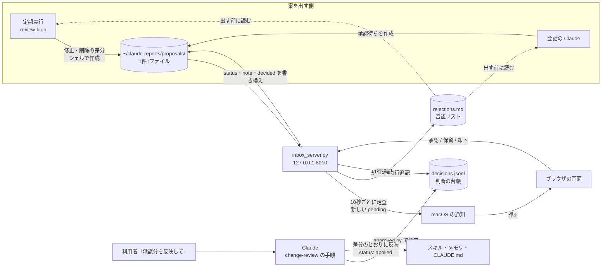

# claude-review-inbox

| 項目 | 内容 |
| --- | --- |
| 対象 | Claude Code のスキル・メモリ・CLAUDE.md に対する承認待ちの変更 |
| 動作環境 | macOS（`/usr/bin/python3` 3.9 以上、`bash`、`jq`）。通知に `terminal-notifier`（無ければ `osascript`） |
| ライセンス | MIT（[LICENSE](LICENSE)） |

本書は、claude-review-inbox の入れ方・更新・外し方と、仕組みを説明する。

## 1. 概要

Claude Code の決まり（スキル・メモリ・CLAUDE.md）を直す変更のうち、利用者の判断が必要なものを「承認待ち」として1件1ファイルで置き、ブラウザの画面で承認・保留・却下する。

- 承認待ちは `~/claude-reports/proposals/` に、frontmatter 付きの Markdown で置く。書式は [core/skills/change-review/SKILL.md](core/skills/change-review/SKILL.md) が定める。
- 画面は `http://127.0.0.1:8010/` である。手元で常に動く小さな HTTP サーバー（launchd の LaunchAgent）が表示する。
- 承認待ちが増えると、サーバーが macOS の通知を出す。通知を押すと、一覧の画面でその案のカードが開く。
- 却下した変更は否認リスト（`~/claude-reports/proposals/rejections.md`）に残る。案を出す側は、出す前に否認リストを読み、同じ対象・同じ趣旨の修正・削除を二度と出さない。
- 画面は状態を書き換えるだけである。承認した変更の反映は、利用者が会話で「承認分を反映して」と言ったときに Claude が行う。

`install.sh` で入れると、次の4つがそろう。

| 機能 | 内容 |
| --- | --- |
| 承認の画面 | `http://127.0.0.1:8010/` の一覧で、承認・保留・却下する |
| 通知 | 承認待ちが増えたら macOS の通知を出す |
| 承認の決まり | Skill `change-review`。案の書式・承認の判定・反映の手順を定める |
| 週1回の棚卸し（任意） | Skill `review-loop`。週1回 `claude -p` が自作のスキルとメモリを読んで改善案を作る。追加はその場で反映し、修正と削除は承認待ちにする。`install.sh` が入れるかを聞く（「4.1 週1回の棚卸し」） |

### 1.1 承認制にする範囲

| 変更 | 扱い |
| --- | --- |
| CLAUDE.md の変更（追加を含む） | 承認待ち |
| 会話の履歴から作った決まりの案 | 承認待ち |
| Claude Code の安全チェックに止められた、自身の決まりの変更 | 承認待ち |
| 定期実行が自分で見つけたスキル・メモリの修正と削除 | 承認待ち。定期実行のスクリプトが案を作る |
| 定期実行が自分で見つけたスキル・メモリの追加（既存の行を変えない・消さない変更） | 承認なしで反映し、記録だけ残す |
| 会話の中でのスキル・メモリの直し | 対象外 |

## 2. 構成

| パス | 内容 |
| --- | --- |
| `install.sh` | 入れる・外す。オプションは `--with-schedule`・`--no-schedule`・`--dry-run`・`--uninstall` |
| `core/skills/change-review/` | 承認待ちの手順（`SKILL.md`）と `scripts/`（承認済みの判定 `approved.py`、件数の集計 `count.sh`、案の作成 `new-proposal.sh`・`diff-label.sh`、共通部品 `proposal_lib.py`） |
| `core/server/inbox_server.py` | 画面・ボタンの処理・置き場所の見張りと通知 |
| `core/skills/review-loop/` | 週1回の棚卸しの説明（`SKILL.md`）と起動スクリプト（`scripts/run.sh`） |
| `core/launchd/claude-review-inbox.plist.template` | サーバーの plist のひな形。`install.sh` がパスとラベルを埋める |
| `core/launchd/review-loop.plist.template` | 棚卸しの plist のひな形。`install.sh` がラベル・パス・時刻を埋める |
| `core/hooks/session-start.sh` | SessionStart フック。「承認待ち N件・承認済み・未反映 N件」を1行出す |
| `core/tests/` | テスト。`core/tests/run.sh` で全部動く |
| `LICENSE` | MIT License |

## 3. 仕組み



### 3.1 承認の改ざん対策

案のファイルの `status: approved` は誰でも（定期実行の `claude -p` でも）書けるため、それだけでは承認として扱わない。

1. 画面のボタンが押されるたびに、サーバーが判断の台帳 `~/.local/state/claude-review-inbox/decisions.jsonl` に1行追記する。項目は `id`・`to`・`note`・`sha256`（frontmatter を除いた本文の SHA-256）・`at` である。
2. 反映の手順では、ファイルの `status: approved`、台帳の最新の行が `approved`、台帳の `sha256` と今の本文の SHA-256 の一致、の3つがそろった案だけを承認済みとする。判定は `core/skills/change-review/scripts/approved.py` が出す。
3. 定期実行の `claude -p` には、台帳と承認待ちの置き場所への書き込みを許可しない（`core/skills/review-loop/scripts/run.sh` の `--disallowedTools`）。
4. 利用者が会話で直接「01 を承認」と言った場合は、台帳が無くても承認として扱う。

### 3.2 画面の守り

| 対策 | 内容 |
| --- | --- |
| 待ち受け | `127.0.0.1` だけで待ち受ける |
| DNS rebinding 対策 | `Host` ヘッダーが `127.0.0.1:<ポート>` か `localhost:<ポート>` でなければ 403 を返す |
| CSRF 対策 | POST は `Origin`（無ければ `Referer`）が自分自身のオリジンのときだけ受け付ける。JSON の判断（`POST /api/proposals/<名前>/decide`）は、`Content-Type: application/json` 以外を 415 で拒否する |
| パスの検査 | 案の名前は `<YYYY-MM-DD>-<連番2桁>[-<短い名前>]` の形だけを受け付け、`..` とフォルダ外を指すパスを拒否する |
| 表示 | 案の本文はすべてエスケープして出す。画面のスクリプトは `/static/app.js` だけで、案の文字列は `textContent` で入れる。`Content-Security-Policy` は `script-src 'self'`・`connect-src 'self'` とし、インラインのスクリプトと外部の資源を禁止する |

### 3.3 通知

- サーバーは10秒ごとに承認待ちの置き場所を走査する（標準ライブラリだけで動かすため、FSEvents は使わない）。
- 通知済みの id は `~/.local/state/claude-review-inbox/notified.json` に持つ。初めて起動したとき（このファイルが無いとき）は、既存の承認待ちを通知済みとして記録するだけで通知しない。
- 1件増えたら、タイトル「承認待ちが届きました」、本文に案の見出しを出す。押すと `/?status=pending#<id>` を開き、その案のカードへ移って枠を強調する。複数件が同時に増えたら「承認待ちが N件届きました」の1件にまとめる。
- 通知は `terminal-notifier` で出す。`terminal-notifier` が無いか、終了コード 0 以外で終わったときは、標準エラーの内容を `server.log` に残してから `osascript` で出し直す。
- `server.log` には、成功したときだけ「通知しました（<手段>）: <id>」と書く。すべての手段が失敗したときは「通知に失敗しました: <id>（理由: …）」と書く。失敗した案も通知済みとして記録し、同じ案で通知を繰り返さない。

## 4. 入れ方

1. リポジトリを clone する。**`~/Documents`・`~/Desktop`・`~/Downloads` の下には置かない。**

   ```sh
   git clone <このリポジトリの URL> ~/dev/claude-review-inbox
   cd ~/dev/claude-review-inbox
   ```

   launchd から動くサーバーと定期実行は、macOS のプライバシー保護により、これらのフォルダのファイルを開けないことがある。開けないときは、サーバーが `[Errno 1] Operation not permitted` で起動しない。
   許可を足して回避すると、使う Python を通じてすべてのスクリプトに同じ許可が付くため、置き場所で避ける。

2. 行う操作を確かめる。何も変えずに、行う操作だけを表示する。

   ```sh
   ./install.sh --dry-run
   ```

3. 入れる。

   ```sh
   ./install.sh
   ```

   途中で「週1回の棚卸しを入れますか [y/N]」と聞かれる。棚卸しは利用者の Claude の利用枠を使うため、`y` と答えたときだけ登録する。詳しくは「4.1 週1回の棚卸し」を参照する。

4. ブラウザで `http://127.0.0.1:8010/` を開き、一覧が表示されることを確かめる。

`install.sh` は次を行う。何回実行しても結果は同じになる。

| No | 操作 | 備考 |
| --- | --- | --- |
| 1 | `terminal-notifier` が無く `brew` があれば `brew install terminal-notifier` | どちらも無ければ警告して続ける。通知は `osascript` で出し、押しても画面は開かない |
| 2 | `terminal-notifier` があれば、試しの通知を1回出す | 失敗したら、アプリとして1回起動してからもう一度試す。それでも失敗したら許可の手順を表示して続ける（「5. 通知の許可」）。`--dry-run` では出さない |
| 3 | `core/skills/*` を、スキル置き場へシンボリックリンクで置く | スキル置き場は `~/.claude/skills` と、`~/.claude2` があれば `~/.claude2/skills`。リンクなら実体を解決し、同じ実体へ二重に置かない。リンクに書かれたパスがリポジトリ内のパスと一致すれば何もしない。一致しないが実体をたどるとこのリポジトリを指すリンク（リポジトリを移す前の旧位置を経由するリンクなど）は、その場で張り直す。それ以外で同じ名前のものが既にあれば `<スキル置き場>/.trash/<YYYYMMDD-HHMMSS>-<名前>` へ移してから置く |
| 4 | `~/Library/LaunchAgents/<ラベル>.plist` を作り、`launchctl bootstrap gui/<UID>` で登録する | 登録済みなら `launchctl bootout` してから登録する。ラベルの既定は `com.<ユーザー名>.claude-review-inbox`（ユーザー名のドットはハイフンに置き換える） |
| 5 | 週1回の棚卸しを、聞いてから登録する | 「4.1 週1回の棚卸し」を参照する。登録した定期実行は `~/.local/state/claude-review-inbox/scheduled-jobs.tsv` に記録する |
| 6 | 各設定ディレクトリの `settings.json` の `hooks.SessionStart` に `core/hooks/session-start.sh` を足す | `jq` で行う。既にあれば足さない。書き換える前に `settings.json.bak-<YYYYMMDD-HHMMSS>` を残す |
| 7 | `~/claude-reports/proposals/` と `~/.local/state/claude-review-inbox/` を作る | |

設定は環境変数で変えられる。

| 変数 | 既定値 | 用途 |
| --- | --- | --- |
| `CLAUDE_REVIEW_LABEL` | `com.<ユーザー名>.claude-review-inbox` | launchd のラベル |
| `CLAUDE_REVIEW_PORT` | `8010` | 画面のポート。plist に書き込まれる |
| `CLAUDE_REVIEW_PYTHON` | `/usr/bin/python3` | サーバーを動かす Python |
| `CLAUDE_REVIEW_LOOP_WEEKDAY` | `1` | 棚卸しの曜日（0 と 7 が日曜、1 が月曜）。plist に書き込まれる |
| `CLAUDE_REVIEW_LOOP_HOUR` | `10` | 棚卸しの時。plist に書き込まれる |
| `CLAUDE_REVIEW_LOOP_MINUTE` | `0` | 棚卸しの分。plist に書き込まれる |
| `CLAUDE_REVIEW_LOOP_MODEL` | なし | 棚卸しの `claude` に渡す `--model`。指定したときだけ plist に書き込まれる。無ければ利用者の既定のモデルを使う |
| `CLAUDE_REVIEW_LOOP_EFFORT` | なし | 棚卸しの `claude` に渡す `--effort`。扱いは `CLAUDE_REVIEW_LOOP_MODEL` と同じ |

サーバーのログは `~/.local/state/claude-review-inbox/server.log`（標準出力）と `server.err.log`（標準エラー）に出る。

### 4.1 週1回の棚卸し

棚卸しは、週1回 `claude -p` を動かし、自作のスキルとメモリを読んで改善案を作る。**利用者の Claude の利用枠を使う。** そのため、`install.sh` は登録する前に聞く。

| 実行のしかた | 棚卸しの扱い |
| --- | --- |
| `./install.sh`（端末から実行） | 「週1回の棚卸しを入れますか [y/N]」と聞く。`y` なら登録し、それ以外なら登録しない（登録済みなら外す） |
| `./install.sh --with-schedule` | 聞かずに登録する |
| `./install.sh --no-schedule` | 聞かずに登録しない（登録済みなら外す） |
| 標準入力が端末でなく、上の2つの指定も無い | 登録しない。既に登録していれば、そのまま残す |

時刻とモデルを変えるときは、環境変数を付けて登録し直す。既定は毎週月曜 10:00、モデルの指定なしである。

```sh
CLAUDE_REVIEW_LOOP_WEEKDAY=5 CLAUDE_REVIEW_LOOP_HOUR=18 CLAUDE_REVIEW_LOOP_MINUTE=30 \
CLAUDE_REVIEW_LOOP_MODEL=sonnet ./install.sh --with-schedule
```

棚卸しの動き（対象・書き戻しの条件・1回あたり5件の上限・結果とログの置き場所）は [core/skills/review-loop/SKILL.md](core/skills/review-loop/SKILL.md) に書いた。結果は `~/claude-reports/review-loop/<YYYY-MM-DD>.md` に出る。

## 5. 通知の許可

**通知は `terminal-notifier` のアプリとして許可する。** `install.sh` が試しの通知を出し、必要ならアプリとして1回起動して、許可を求める。

| 項目 | 内容 |
| --- | --- |
| いつ聞かれるか | `install.sh` の実行中。試しの通知（「claude-review-inbox の通知の確認です」）が失敗したときに、`terminal-notifier.app` をアプリとして1回起動する。このときに許可を求められる |
| どのアプリとして聞かれるか | `terminal-notifier`。`terminal-notifier` が無い環境では `osascript` の実行元 |
| なぜ必要か | 承認待ちが届いたことを、画面を開いていなくても知らせるため |
| 許可しなかった場合 | 通知は出ない。サーバーは `osascript` で出し直し、それも失敗したら `server.log` に「通知に失敗しました」と書く。承認待ちは画面と SessionStart フックの1行で確かめられる |

### 5.1 アプリとして起動する

Homebrew の `terminal-notifier` は、コマンドとして実行しても許可のダイアログが出ず、「システム設定」の「通知」の一覧にも現れないことがある。このとき、標準エラーに `Notifications are not allowed for this application` を出して終了コード 3 で終わる。次のコマンドでアプリとして1回起動すると、以後はコマンドからの通知が成功する。

  ```sh
  open -W -a "$(brew --prefix terminal-notifier)/terminal-notifier.app" --args -title claude-review-inbox -message "claude-review-inbox の通知の確認です"
  ```

### 5.2 一覧に出ないとき

1. 上の `open -W -a …` のコマンドを実行する。
2. 「システム設定」の「通知」を開き、一覧の `terminal-notifier` を選んで「通知を許可」を有効にする。
3. `terminal-notifier -title test -message test; echo $?` で、終了コードが 0 になることを確かめる。

このほかに、`install.sh` とサーバーが求める許可は無い。

## 6. 困ったとき

| 症状 | 確かめる場所と表示 | 原因と対処 |
| --- | --- | --- |
| サーバーが起動しない（画面が開かない） | `~/.local/state/claude-review-inbox/server.err.log` に `Operation not permitted` | リポジトリを `~/Documents`・`~/Desktop`・`~/Downloads` の下に置いている。macOS のプライバシー保護で launchd から開けない。`~/dev` などへ移し、`./install.sh` を実行し直す（リンクは張り直される） |
| 通知が出ない | `server.err.log` または `server.log` に `Notifications are not allowed` | `terminal-notifier` に通知の許可が無い。「5.2 一覧に出ないとき」の手順で許可する |
| 通知が出ない | `server.log` に「通知に失敗しました」 | すべての手段が失敗した。同じ行の理由を確かめる。失敗した案は再び通知しないため、画面で確かめる |

## 7. 更新

```sh
cd ~/dev/claude-review-inbox
git pull
./install.sh
```

スキルはリポジトリの中のディレクトリへのシンボリックリンクのため、`git pull` だけで新しい版になる。サーバーの変更を反映するには `./install.sh` をもう一度実行する（launchd に登録し直す）。

## 8. 外し方

```sh
./install.sh --uninstall --dry-run   # 行う操作を確かめる
./install.sh --uninstall
```

`--uninstall` は次を行う。

- launchd から外し、plist を消す。
- `install.sh` が登録した定期実行（`scheduled-jobs.tsv` に記録したもの）を外し、plist を消す。手で登録した plist のうち、`install.sh` が登録していないものは外さない。
- スキル置き場のうち、このリポジトリを指すシンボリックリンクだけを消す。
- `settings.json` から、足したフックだけを消す（書き換える前に `settings.json.bak-<YYYYMMDD-HHMMSS>` を残す）。
- `.trash` へ退避したスキルは自動では戻さず、戻すコマンド（`mv '<退避先>' '<元の場所>'`）を表示する。
- 承認待ちの置き場所と判断の台帳は消さない。

## 9. 使い方

| したいこと | 方法 |
| --- | --- |
| 承認待ちを見る | 画面の「承認待ち」のタブ。会話で「承認待ちを見せて」と言ってもよい |
| 承認・保留・却下する | 一覧のカードのボタン。ページは移らず、カードが今のタブから外れる。メモ欄に理由を書くと、却下のときは否認リストに残る |
| 直前の操作を取り消す | 操作の後に画面の下に出る知らせの「元に戻す」を押す。知らせは8秒で消える |
| 却下を取り消す | 「却下」のタブで「承認待ちに戻す」などを押す。否認リストからその行が消える |
| JavaScript を使わずに判断する | カードのボタンはフォームの送信としても動く。送信後は案の画面（`/p/<名前>`）へ移る |
| 承認した変更を反映する | 会話で「承認分を反映して」と言う。Claude が `approved.py` で判定し、差分の `-` 行が今のファイルと一致するものだけを反映する。一致しないものは `hold` にしてメモに理由を書く |

## 10. テスト

```sh
core/tests/run.sh
```

| テスト | 確かめる内容 |
| --- | --- |
| `core/tests/test_server.py` | 一覧（カードの理由・差分・メモ欄・ボタン、反映済みは読むだけ）・詳細・JSON の判断（各状態への遷移・否認リスト・台帳・誤った要求）・`Content-Type` が違う POST の 415・`Origin` と `Host` が違う JSON の POST の 403・`/static/app.js` の配信と CSP の見出し・各状態への遷移・否認リストへの追記と削除・台帳への追記・`Origin` と `Host` の拒否・パストラバーサルの拒否・初回の起動で通知しないこと・2回目以降は増えた分だけ通知すること・`terminal-notifier` が失敗したときに `osascript` へ切り替えること・通知の成否のログ |
| `core/tests/test_approved.py` | 承認済みの判定（台帳あり・なし・本文の書き換え・最新が approved でない）、件数の集計、案の作成 |
| `core/tests/test_hook.sh` | SessionStart フックの出力 |
| `core/tests/test_install.sh` | 一時の `HOME` と偽の `launchctl`・`brew`・`open`・`terminal-notifier` で、入れる・2回実行・`--dry-run`・`--uninstall`・旧位置を経由したリンクの張り直しと外し方・試しの通知 |
| `core/tests/test_install_schedule.sh` | 一時の `HOME` と偽の `launchctl` で、棚卸しの登録（非端末・聞かれて `n`／`y`・`--with-schedule`・`--no-schedule`・時刻とモデルの指定・2回実行）、`--uninstall`、`--dry-run`。端末からの実行は疑似端末で模す |
| `core/tests/test_review_loop.sh` | 偽の `claude` で、棚卸しの対象の選び方、追加の書き戻し、修正・削除・新しいファイルを案にして元を変えないこと、依頼文の否認リストのパス、`--dry-run`、`--model` の有無、対象が変わらなければ起動しないこと、異常終了、5件の上限、二重起動の防止 |
| `core/tests/test_link_scopes.sh` | 一時の `HOME` に実体が別のフォルダにあるリンクのスキルを置き、棚卸しの `--dry-run` の出力に実体の `Read` が1回ずつ入ること、実体の無いリンクで落ちないこと、リンクの先の実体の `Edit` を拒否すること |
| `core/tests/test_destinations.sh` | 修正と削除の案に付ける、消える記述の行き先 |

テストは本物の `HOME`・`launchctl`・`brew` に触れない。サーバーのテストは空いているポートで起動し、通知のコマンドを環境変数 `CLAUDE_REVIEW_NOTIFY_CMD` で差し替えて記録する。通知の切り替えの検査では、`terminal-notifier` を偽のコマンドに、`osascript` を環境変数 `CLAUDE_REVIEW_OSASCRIPT` で偽のコマンドに差し替える。

### 10.1 画面の動作の確かめ方（手動）

一覧の画面の JavaScript は自動のテストを持たない。テスト用の置き場所で別のポートにサーバーを起動し、ブラウザで次を確かめる。

```sh
CLAUDE_REVIEW_PORT=18010 CLAUDE_REVIEW_PROPOSALS=/tmp/review-check/proposals \
CLAUDE_REVIEW_STATE=/tmp/review-check/state CLAUDE_REVIEW_NOTIFY_CMD=true \
/usr/bin/python3 core/server/inbox_server.py
```

| No | 操作 | 正しい結果 |
| --- | --- | --- |
| 1 | `http://127.0.0.1:18010/` を開く | 承認待ちのカードが並び、差分が開いている。他のタブでは差分が閉じている |
| 2 | タブを押す | ページを移らずに一覧が変わり、URL の `?status=` が変わる。再読み込みすると同じタブが開く |
| 3 | カードの「承認する」を押す | カードが消え、タブの件数が変わり、画面の下に「<番号> を承認しました」と「元に戻す」が出る。8秒で消える |
| 4 | 「元に戻す」を押す | 案が直前の状態へ戻り、カードが元のタブに戻る |
| 5 | サーバーを止めてからボタンを押す | カードが残り、カードの中にエラーの文言が出る。メモ欄の内容は残る |
| 6 | メモ欄に入力したまま、別の端末かファイルの書き換えで案を増やして3秒待つ | 件数と一覧が更新され、入力中のカードは書いた内容のまま残る |
| 7 | 「反映済み」のタブを開く | ボタンとメモ欄が無い |
| 8 | `/?status=pending#<id>` を開く | そのカードへ移り、枠が強調される |
| 9 | Tab キーだけで操作する | タブ・メモ欄・ボタン・「元に戻す」にフォーカスの枠が見え、Enter で押せる |
| 10 | ブラウザの JavaScript を切ってボタンを押す | 案の画面へ移り、判断が記録されている |
| 11 | 幅 400px にする・暗い配色にする | カードが崩れず、文字が読める |
| 12 | 画面を開いたまま、別の端末で `CLAUDE_REVIEW_PROPOSALS` を同じ置き場所にして `core/skills/change-review/scripts/new-proposal.sh` で案を作る | 再読み込みせずに数秒以内にカードが増え、「新着」の印と緑の枠が数秒付く。画面の下に「承認待ちが 1 件届きました」が出る |
| 13 | 案が増えない間、開発者ツールのネットワークの欄と画面を見る | 3秒ごとに `/api/proposals` を取得するが、スクロールの位置・開いた差分・メモ欄の入力・フォーカスが変わらない |
| 14 | 「保留」のタブを開いたまま、承認待ちの案を作る | 一覧は変わらず、「承認待ち」のタブの件数だけが増える |
| 15 | 別のタブに切り替えて案を作り、元のタブに戻る | 隠れている間は取得しない。戻った直後に取り直し、カードが増える |
| 16 | サーバーを止めて3秒待ち、もう一度起動する | 止めている間は画面の上部に「サーバーに接続できません。再接続を試みています」が出る。起動し直すと数秒以内に消える |

## 11. 元になった考え方

Claude が自分の決まり（スキル・メモリ・CLAUDE.md）を育てる仕組みでは、誤った修正が気付かれずに残りやすい。とくに定期実行は利用者が見ていない場で動く。そこで、既存の行を変えない追加はそのまま反映し、既存の記述を変える修正と削除だけを利用者の承認制にする。承認は画面のボタンで行い、判断の台帳と本文のハッシュで、承認の記録を書き換えられないようにする。

## 12. ライセンス

MIT License である。全文は [LICENSE](LICENSE) にある。

## 13. 未検証の事項

launchd からの起動、実物の通知、実物の `claude -p` による棚卸しは、テストの偽のコマンドでしか確かめていない。導入後に `server.log` と棚卸しのログで確かめる。
